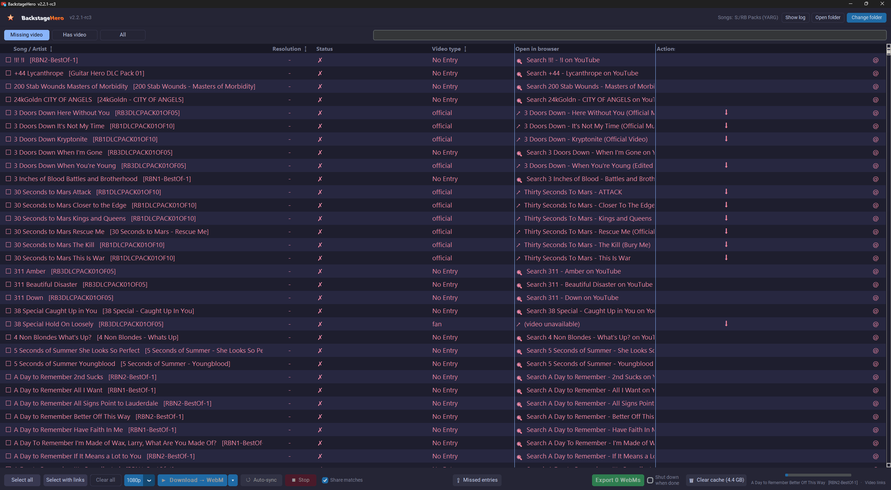

<p align="center">
  
</p>

<h1 align="center">BackstageHero</h1>

<p align="center">Downloads background videos for your Clone Hero songs and lines them up with the charts.</p>

<p align="center">
  <a href="https://github.com/jmb988/BackstageHero/releases/latest">
    
  </a>
</p>

---



If a song folder has a `video.mp4` in it, Clone Hero plays it behind the chart. Doing that by hand across a whole library takes forever. This searches YouTube for the ones that are missing it, downloads a match, and lines the video up so it starts with the song.

Point it at your Songs folder and it fills in whatever doesn't have a video yet.

## Install

Download `BackstageHero.exe` from the [latest release](https://github.com/jmb988/BackstageHero/releases/latest) and run it. It asks for your Songs folder the first time. ffmpeg is inside the exe, so there's nothing else to install.

Songs that already have a video are skipped, so re-running after you add charts is fine. You can close it mid-run; it cleans up the song it was on and picks up again next time.

## New in v2

- proper GUI instead of the old console prompts. you can see the whole library, filter by what's missing a video, and check resolutions
- it works out the timing itself now, by matching the video's audio against the chart audio instead of dropping the same offset on everything
- manual offset editor for the ones it gets wrong. right click a song, drag the slider, the preview follows
- optional sharing: turn it on and once a few people land on the same offset for a chart, that becomes the default for anyone else who downloads it
- updates itself, and keeps yt-dlp updated too (it has to, YouTube breaks it every few weeks)

## Rock Band CON packs (YARG)

It also works on packed Rock Band CON/LIVE files, the way [YARG](https://wiki.yarg.in/wiki/Backgrounds) reads background videos: one video per song, next to the CON, named after the song ID (shortname). For example `RB1\creep.webm` for the song `creep` inside `RB1\RB1_pack`. The CON itself is never touched, so instead of writing an offset, the video gets cut (or padded) so it starts with the song.

A folder with a `.yargignore` file in it (any case) is skipped, the way YARG skips it with [the `.yargignore` change in AARP41298's YARG.Core](https://github.com/AARP41298/YARG.Core/tree/master-personal): its songs and CONs aren't listed, its sub-folders still are. This applies to Clone Hero song folders too.

Reading the songs and the audio needs a build of [Nautilus](https://github.com/NemosNautilus/Nautilus) ([AARP41298's fork, branch `master-backstage`](https://github.com/AARP41298/Nautilus/tree/master-backstage)) with the `-backstagehero` command line (it lists the songs with their `game_origin` and decrypts the mogg). Point BackstageHero at `Nautilus.exe` the first time it finds a CON. The mogg tracks are mixed at -5 dB to match against the video.

CON songs don't render right away. After the download the song shows **Review download** (or **Review download (auto-edit, N edits)** when the video had to be rebuilt, see [Auto-edit](#auto-edit)) and the Actions column gives you:

- **▶** play the downloaded video in your default player
- **⬇** download the video type picked in the Video type column from the database, or download it again (also for songs that already have a video, after confirming)
- **👁** preview: a quick 480p render of the edit (not an export), played in the 🎧 window with the CON audio on the left and the video's audio on the right
- **MP4** / **WebM** render the synced video next to the CON and mark the YouTube video as good. WebM uses YARG's recommended settings (VP8 2-pass, keyframe every 128 frames, Opus 128k) and is much smaller, but takes a few times longer than MP4
- **🗑** clear cache: delete the song's kept original download (see below)
- **@** video links for the song (see [the music video database](#the-music-video-database))

Exporting keeps the original download in the cache (in the app's data folder), so you can export a quick MP4 to check the result (auto-edit included) and then the WebM, without downloading again. **Queue as MP4** / **Queue as WebM** put songs in the export queue and the green **▶ Start export** renders them one at a time; while it's on, songs queued later export too, and **⏸ Pause export** lets the current file finish and keeps the rest queued; **☰ Queue** lists what's queued and exporting (click a song to show it in the table). If the song already has the other format, queuing asks whether to replace it or keep both; the log (**Show log**) lists each export's size so you can compare MP4 and WebM. Closing the app while a video exports asks whether to quit now, after the current file or after the queue. **🗑 Clear cache** in the bottom bar deletes every kept download.

The **▾** next to the start button picks what it does with CON songs: **Search & Review** (the above), **Download → WebM** or **Download → MP4** (each song is exported as soon as its download is ready, while the next ones download; a download that couldn't be synced stays for review instead). With **Shut down when done**, Download → WebM shuts down after the last export. **Select with links** selects the songs in view whose Video type has a database link, the ones downloaded without a YouTube search.

Rendered videos have their black bars cropped (letterbox or pillarbox, snapped to a standard ratio such as 4:3, 16:9 or 2.35 Scope, so no picture is lost), keep their audio track (for fixing by hand later), get a small BackstageHero watermark for the first 3 seconds, and are tagged in their metadata. Re-downloading (or **⬇** on) a video that wasn't made by BackstageHero asks twice, so videos you synced by hand don't get replaced by accident. Those videos show **⚠** in the Status column (song folders: no `backstagehero_source` in song.ini; CON videos: no BackstageHero tag, read in the background after the scan).

## Auto-edit

Official music videos often aren't the album cut: a long intro, an interlude
or skit, one chorus fewer, a slightly different tempo. A single offset can't
sync those. After a CON download, auto-edit maps the whole video onto the
song audio and, when it needs more than an offset, rebuilds it: it cuts the
extra parts, re-uses footage where the song is longer and adjusts the speed.

Every edit is logged in plain words:

```
segment 1:37.476-1:45.747 was cut
at 0:18.608, the fragment 0:02.900-0:18.619 was inserted
segment 0:00.000-1:37.476 change speed by -0.48%
```

Examples (click to open):

<details>
<summary><b>Beck - E-Pro</b>: the music video is too short? It reuses footage that fits the song</summary>

<br>

The music video is shorter than the album track, so parts of the song
aren't in it. A single offset would sync the start, then fall out of step
at the first missing part and run out of video before the song ends.
Auto-edit finds the parts of the song the video doesn't have and fills them
by reusing (or looping) the video's footage of the same music from
elsewhere in the video, so the picture stays in sync until the end.

[▶ Watch the E-Pro example](assets/epro.mp4)

</details>

<details>
<summary><b>Paramore - Decode</b>: no footage before the song starts? It adds black frames for a perfect sync</summary>

<br>

The chart starts with a silent count-in, but the video starts right on
the first note, with no intro to spare. Starting the video right away
would put it ahead of the song for the whole track. Auto-edit adds black
frames at the beginning for exactly the length of the count-in, so the
video's first frame lands on the song's first note. Where the chart audio
already has music, it holds the first frame (up to 3 s) or reuses footage
from the first half of the video instead of going black.

[▶ Watch the Decode example](assets/decode.mp4)

</details>

When the auto-edit can't get a song right, **Editor** hands it to a video
editor: pick Premiere Pro, DaVinci Resolve, Final Cut Pro, Shotcut or
[auto-editor](https://github.com/WyattBlue/auto-editor) and it makes a
folder with the video, the CON audio and the edit as a timeline, to finish
by hand. From the command line it also works on any video/audio pair. `aspectcrop.py` does the black bar crop on
its own. See [AUTOEDIT.md](AUTOEDIT.md).

## The music video database

[mvdb/](mvdb/) lists which video goes with which chart, and how it was
synced: one JSON per song source (`rb3dlc`, `ugc2`, `c3customs`, ... the
Rock Band 3 Deluxe source keys), with four types of video:

- **official**: the official music video
- **alternate**: a live performance, visualizer or live visual that matches the album audio
- **fan**: a fan video or fan edit
- **meme**: a TV/movie/game clip or meme set to the song

It starts with the ~570 syncs of the community
[Clone Hero Background Video Time Codes](https://docs.google.com/spreadsheets/d/1QJ7wotWFoNNSwzIIIAGRcf4WAaYz1pXjhljYSk5h9DI/htmlview)
sheet. Songs are matched by CON ID, else by artist and title (and the CON ID
gets linked). In the song list:

- **Video type** shows the type that will be used (official by default) with
  a `*` when there are other types, `(no link)` when the database only has
  the offset, or **No Entry**. Click it to pick another type; click the
  header to sort. A CON song with 2+ links can pick **auto-mix**: the
  official video with the movie / game clips that use the song put in where
  they fit (meme on top by default; **Auto-mix priority...** orders the
  song's videos, listed by their YouTube titles).
- **Open in browser** shows the YouTube title of that video and opens it.
- **@** opens the song's video links: every type with its link, **Edit** for a
  wrong one, **Set link** for a missing one, and **Search on YouTube**. Memes
  can have several links (**+ Add meme link**), one per movie, show or game.

Linked videos are tried before the YouTube search; when the audio sync can't
measure an offset, the database's is used. No Entry songs just use the search.

The links you set or fix are saved on your PC. **⇪ Missed entries** writes
them (plus the videos you rendered) to `missed_entries.json` with your name
in `submitted_by`; attach it to an issue or pull request to add them to the
database. See [MVDB.md](MVDB.md).

Only the checkbox selects a song; clicking elsewhere on a row doesn't.

## How the timing works

Every music video has a different amount of intro before the song starts, so you can't use one offset for everything. Once it's picked a video it grabs the audio and matches it against the chart's stems to find where they line up. It compares the pattern of peaks rather than the raw audio, so a louder or differently mastered YouTube version still matches. If it's sure, it writes the offset into `video_start_time`. If it isn't (live version, remix, just the wrong video) it leaves the default and you fix that one by hand.

Official music videos usually just work. The ones that need a manual pass are custom charts with edited intros, replaced audio, or no audio in the chart to match against at all. Whatever you set in the editor can be shared too.

## Why it still works

It uses yt-dlp with its default settings and keeps yt-dlp updated on its own, so when YouTube breaks something and yt-dlp patches it, the fix shows up within a day or so, no new release needed.

On a big run YouTube will start throttling. It waits at least 30 seconds between songs to stay under that and eases off automatically when it gets pushback, so most runs just ride it out. A hard IP block is on YouTube's end and waiting it out is the only fix there, but nothing gets lost or redone when you come back to it, since anything that already has a video is skipped.

## From source

```
git clone https://github.com/jmb988/BackstageHero
cd BackstageHero
pip install -r requirements.txt
python gui.py
```

yt-dlp needs Python 3.11 or newer. Timing needs ffmpeg on your PATH or sitting in the project folder. Static Windows builds are at [BtbN/FFmpeg-Builds](https://github.com/BtbN/FFmpeg-Builds/releases).

## Building the exe

```
pip install -r requirements.txt
python build.py
```

The script does everything else on its own:

1. stops right away if a requirement (yt-dlp, numpy, ...) is missing for the Python running it, since PyInstaller would otherwise build an exe without it
2. installs PyInstaller (and Pillow) if they're missing
3. converts `assets/icon.png` to an `.ico` and generates the header logo and splash image (`make_brand.py`)
4. downloads `ffmpeg.exe` from [BtbN/FFmpeg-Builds](https://github.com/BtbN/FFmpeg-Builds/releases) if it isn't in the folder yet (set `FFMPEG_URL` to pin a specific build)
5. downloads `libmpv-2.dll` for the embedded preview in the sync editor. Extracting it needs 7-Zip or WinRAR installed; without it the build still works and the editor falls back to ffplay
6. packs everything into a single `dist/BackstageHero.exe` and writes `dist/BackstageHero.exe.sha256` next to it

The first build takes a few minutes because of the downloads. After that `ffmpeg.exe` and `libmpv-2.dll` are reused.

To release, tag the GitHub release with a version newer than the last one and upload both `BackstageHero.exe` and `BackstageHero.exe.sha256`, so the in-app updater picks it up and can verify it.

Nautilus isn't bundled. CON support uses whatever `Nautilus.exe` you point it at (see [Rock Band CON packs](#rock-band-con-packs-yarg)).

## Credits

ffmpeg ([BtbN builds](https://github.com/BtbN/FFmpeg-Builds), GPLv3) and [yt-dlp](https://github.com/yt-dlp/yt-dlp) do the real work.

Rock Band CON packs are read with [Nautilus](https://github.com/NemosNautilus/Nautilus) by NemosNautilus: listing the songs, `game_origin` and decrypting the audio all come from it.

The music video database starts from the Clone Hero Background Video Time Codes sheet by moocartoons and its contributors. Song source keys follow [Rock Band 3 Deluxe](https://github.com/hmxmilohax/rock-band-3-deluxe). Auto-edit's terms and timeline export follow [auto-editor](https://github.com/WyattBlue/auto-editor).
